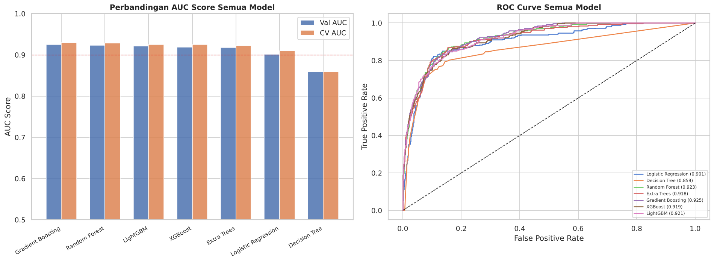
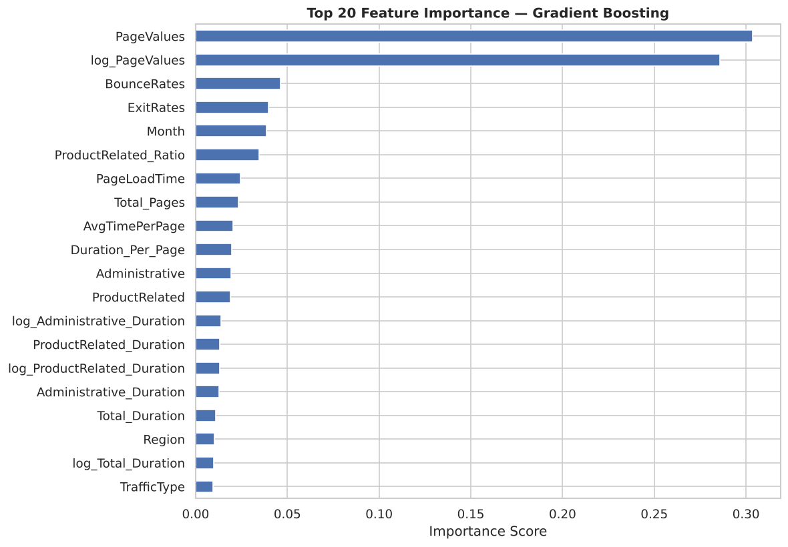
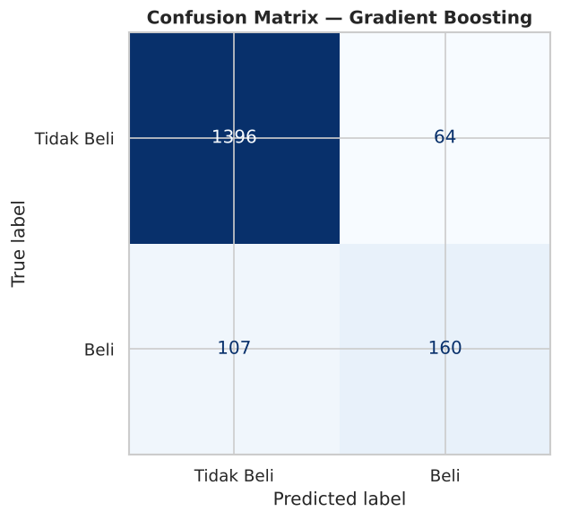
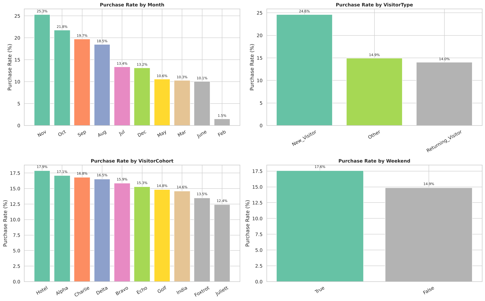

<div align="center">

# 🏆 Kaggle Classification Projects

**Dua proyek klasifikasi biner dari kompetisi Kaggle mata kuliah Data Mining: prediksi pembelian pengunjung e-commerce dan prediksi nasabah yang berlangganan deposito.**


</div>

---

## 📋 Ringkasan

| # | Proyek | Masalah | Pendekatan | Hasil Terbaik |
|:---:|---|---|---|:---:|
| 1 | [**Online Shoppers Revenue Prediction**](#1--online-shoppers-revenue-prediction) | Apakah sesi kunjungan website berakhir dengan pembelian? | EDA, 11 fitur hasil *feature engineering*, perbandingan **7 model** | **CV AUC 0,929** (Gradient Boosting) |
| 2 | [**Bank Marketing Term Deposit**](#2--bank-marketing-term-deposit-prediction) | Apakah nasabah akan berlangganan deposito berjangka? | *Feature engineering* (encoding siklikal, interaksi ekonomi), **SVC RBF** terkalibrasi | **OOF AUC 0,773** |

Kedua proyek memakai **ROC-AUC** sebagai metrik utama, sesuai format kompetisi yang menilai prediksi berupa probabilitas. Keduanya juga menghadapi **kelas tidak seimbang** (hanya 11–15% kelas positif).

---

## 1. 🛒 Online Shoppers Revenue Prediction

📁 Folder: [`01-online-shoppers-revenue/`](01-online-shoppers-revenue/) · 📓 Notebook: [`revenue_prediction.ipynb`](01-online-shoppers-revenue/revenue_prediction.ipynb)

### Masalah
Memprediksi apakah sebuah sesi kunjungan website e-commerce akan menghasilkan pembelian (`Revenue = 1`), berdasarkan perilaku browsing seperti jumlah dan durasi halaman yang dikunjungi, *bounce rate*, *exit rate*, *page value*, bulan, dan tipe pengunjung.

| Info | Nilai |
|---|---|
| Data train / test | 8.631 / 3.699 sesi |
| Fitur awal | 20 → **31** setelah *feature engineering* |
| Proporsi kelas | 84,5% tidak beli : 15,5% beli (rasio **5,46 : 1**) |

### Alur Kerja
1. **EDA**: distribusi target, distribusi fitur numerik per kelas, *purchase rate* per kategori, dan korelasi.
2. ***Feature engineering*** (11 fitur baru):
   - Agregasi: `Total_Pages`, `Total_Duration`
   - Rasio: `Duration_Per_Page`, `ProductRelated_Ratio`
   - Flag: `HighBounce`, `HasPageValue`
   - Log transform untuk 5 fitur yang sangat *skewed*
3. **Preprocessing**: *label encoding* untuk fitur kategorik dan `StandardScaler`.
4. **Modeling**: 7 model dengan penanganan *class imbalance* (`class_weight='balanced'` dan `scale_pos_weight`).
5. **Evaluasi**: *validation set* 20% (*stratified*) + **5-fold Stratified CV**.
6. **Submission**: model terbaik dilatih ulang pada seluruh data train, lalu hasilnya diekspor ke CSV dan Excel multi-sheet.

### Hasil

| Model | Val AUC | CV AUC | Precision | Recall | F1 |
|---|:---:|:---:|:---:|:---:|:---:|
| **Gradient Boosting** 🏆 | **0,925** | **0,929** | **0,714** | 0,599 | 0,652 |
| Random Forest | 0,923 | 0,928 | 0,588 | 0,779 | 0,670 |
| LightGBM | 0,921 | 0,925 | 0,603 | 0,734 | 0,662 |
| XGBoost | 0,919 | 0,925 | 0,630 | 0,727 | 0,675 |
| Extra Trees | 0,918 | 0,922 | 0,601 | 0,794 | **0,684** |
| Logistic Regression | 0,901 | 0,909 | 0,586 | **0,820** | 0,683 |
| Decision Tree | 0,859 | 0,859 | 0,530 | 0,768 | 0,627 |

<table>
  <tr>
    <td colspan="2"><b>Perbandingan AUC & kurva ROC 7 model</b><br></td>
  </tr>
  <tr>
    <td width="55%"><b>Top 20 feature importance (Gradient Boosting)</b><br></td>
    <td width="45%"><b>Confusion matrix (validation set)</b><br></td>
  </tr>
  <tr>
    <td colspan="2"><b>Purchase rate per kategori</b><br></td>
  </tr>
</table>

### Insight
- **`PageValues` adalah prediktor paling dominan**: versi asli dan versi log-nya menyumbang lebih dari separuh total *feature importance*. Pengunjung yang membuka halaman bernilai tinggi (misalnya halaman produk sebelum *checkout*) jauh lebih mungkin membeli.
- **Musim berpengaruh**: *purchase rate* tertinggi di **November (25,3%)** dan Oktober (21,8%), sedangkan terendah di Februari (1,5%).
- **Pengunjung baru** justru memiliki *purchase rate* lebih tinggi (24,6%) dibanding pengunjung lama (14,0%).
- **Trade-off AUC vs recall**: Gradient Boosting memiliki AUC dan *precision* tertinggi, tetapi *recall*-nya paling rendah karena tidak memakai bobot kelas. Model dengan `class_weight='balanced'` menangkap lebih banyak pembeli (*recall* hingga 82%) dengan konsekuensi lebih banyak *false positive*. Karena kompetisi dinilai dengan AUC, Gradient Boosting dipilih sebagai model akhir.

---

## 2. 🏦 Bank Marketing Term Deposit Prediction

📁 Folder: [`02-bank-marketing-svc/`](02-bank-marketing-svc/) · 🐍 Script: [`svc_model.py`](02-bank-marketing-svc/svc_model.py)

### Masalah
Memprediksi apakah nasabah akan **berlangganan deposito berjangka** setelah dihubungi kampanye telemarketing bank, berdasarkan data demografis, riwayat kontak kampanye, dan indikator ekonomi makro.

| Info | Nilai |
|---|---|
| Data train / test | 22.916 / 5.729 nasabah |
| Fitur | 20 → **31** setelah *feature engineering* |
| Proporsi kelas | 88,6% tidak berlangganan : 11,4% berlangganan |

### Feature Engineering

| Kelompok | Fitur | Alasan |
|---|---|---|
| Flag biner | `pcontacted`, `was_success`, `was_failure` | Nilai `999` pada `hari_sejak_kontak_sebelumnya` berarti "belum pernah dihubungi", jadi perlu dipisahkan dari angka biasa |
| Riwayat kontak | `total_contacts`, `contact_rate`, `log_campaign_contacts` | Merangkum intensitas kontak; log transform meredam *outlier* |
| **Encoding siklikal** | `month_sin`, `month_cos` | Agar model memahami bahwa Desember "dekat" dengan Januari |
| Ordinal | `day_num`, `age_group` | Urutan hari dan kelompok usia |
| **Interaksi ekonomi** | `euribor × jumlah_pekerja`, `euribor × CPI`, `CCI × CPI` | Menangkap kondisi ekonomi gabungan saat kampanye berlangsung |

### Model
- **SVC (kernel RBF)** dengan `C = 1.5`, `gamma = 'scale'`, dan `class_weight = 'balanced'` untuk menangani *imbalance*.
- **`CalibratedClassifierCV` (Platt scaling, 5-fold)** untuk menghasilkan probabilitas yang terkalibrasi. SVC tidak menghasilkan probabilitas secara langsung, padahal kompetisi menilai prediksi probabilitas.
- Evaluasi memakai **out-of-fold (OOF) 5-fold Stratified CV**.

### Hasil

| Fold | 1 | 2 | 3 | 4 | 5 | **Overall OOF** |
|---|:---:|:---:|:---:|:---:|:---:|:---:|
| AUC | 0,767 | 0,783 | 0,778 | 0,775 | 0,765 | **0,773** |

AUC antar *fold* stabil (0,765–0,783), jadi model tidak *overfit* pada satu bagian data tertentu. Log lengkap tersedia di [`outputs/training_log.txt`](02-bank-marketing-svc/outputs/training_log.txt).

---

## 📁 Struktur Folder

```
kaggle-classification-projects/
├── 01-online-shoppers-revenue/
│   ├── revenue_prediction.ipynb     # Notebook lengkap: EDA → modeling → submission
│   ├── data/README.md               # Cara mendapatkan dataset
│   ├── images/                      # Grafik EDA & evaluasi model
│   └── outputs/submission.csv       # Prediksi probabilitas untuk test set
├── 02-bank-marketing-svc/
│   ├── svc_model.py                 # Script: feature engineering → SVC → submission
│   ├── data/README.md               # Cara mendapatkan dataset
│   └── outputs/
│       ├── submission_svc.csv       # Prediksi probabilitas untuk test set
│       └── training_log.txt         # Log training & AUC per fold
├── requirements.txt
├── LICENSE
└── README.md
```

---

## 🚀 Cara Menjalankan

```bash
# 1. Clone repository
git clone https://github.com/r4dtwhle/kaggle-classification-projects.git
cd kaggle-classification-projects

# 2. Buat virtual environment & install dependensi
python -m venv venv
venv\Scripts\activate          # Windows
# source venv/bin/activate     # macOS / Linux
pip install -r requirements.txt

# 3. Letakkan file dataset di folder data/ masing-masing proyek (lihat data/README.md)

# 4a. Proyek 1: jalankan notebook dari dalam foldernya
cd 01-online-shoppers-revenue
jupyter notebook revenue_prediction.ipynb

# 4b. Proyek 2: jalankan script (±5 menit)
python 02-bank-marketing-svc/svc_model.py
```

> 📌 **Data tidak disertakan** karena berasal dari kompetisi Kaggle. Seluruh output (grafik, metrik, dan prediksi) sudah tersimpan di notebook dan folder `outputs/`, jadi hasilnya tetap bisa dilihat tanpa menjalankan ulang.

---

## 🔭 Pengembangan Selanjutnya

- ***Hyperparameter tuning*** (Optuna atau `RandomizedSearchCV`) untuk Gradient Boosting dan SVC.
- ***Threshold tuning*** berdasarkan kebutuhan bisnis, misalnya memaksimalkan *recall* agar lebih banyak calon pembeli/nasabah yang tertangkap.
- **Ensemble/stacking** beberapa model terbaik.
- Pada proyek 1, *quantile* untuk fitur `HighBounce` dan `StandardScaler` sebaiknya di-*fit* hanya pada data train, lalu diterapkan ke validation/test, untuk sepenuhnya menghindari *data leakage*.

---

<div align="center">
<sub>Dibuat oleh <a href="https://github.com/r4dtwhle">r4dtwhle</a> · Kompetisi Kaggle mata kuliah Data Mining · Lisensi MIT</sub>
</div>
